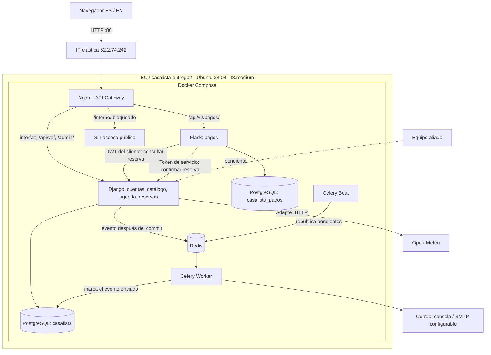
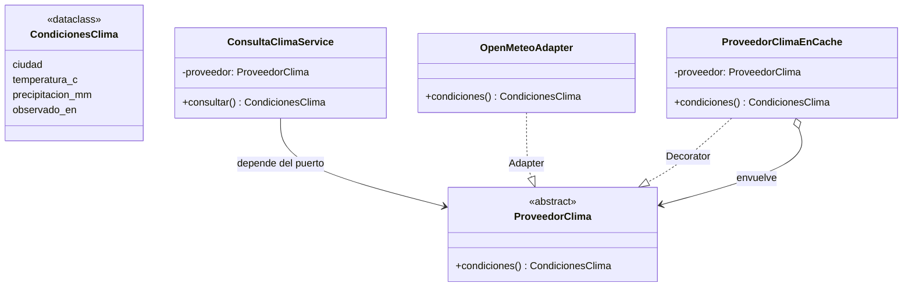
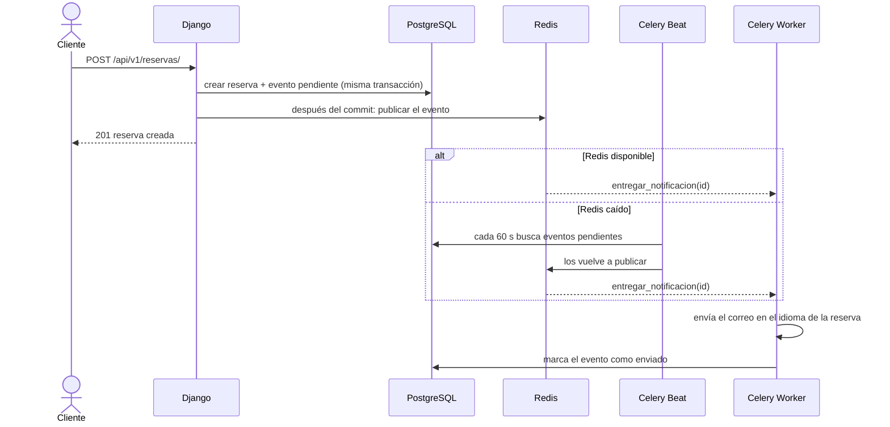

# CasaLista - Entrega 2

**Aplicación desplegada:** http://52.2.74.242 (AWS Academy, EC2 con IP elástica)

## 1. Qué se agregó y cómo se cumple cada punto

| Requisito | Qué se hizo |
|---|---|
| Correcciones de la Entrega 1 | El profesor pidió mejorar el front. Se rediseñó la interfaz (portada, identidad visual, diseño adaptable a celular), se corrigió la ortografía y se resolvieron los hallazgos de la auditoría UI/UX (sección 8) |
| Docker Compose | Siete servicios: PostgreSQL, Redis, Django, Celery worker, Celery beat, Flask (pagos) y Nginx |
| API Gateway | Nginx es el único punto de entrada: enruta a Django o a Flask y bloquea `/interno/` |
| Strangler | El módulo de pagos vive en Flask (`/api/v2/pagos/`) con su propia base de datos; el resto sigue en el monolito Django |
| Endpoint JSON propio | `/api/v1/catalogo/profesionales/` y servicios por profesional, públicos y paginados |
| API de tercero con Adapter + DIP | Clima de Medellín desde Open-Meteo, consumido a través de un puerto abstracto `ProveedorClima` |
| Servicio del equipo aliado | **Pendiente**: no se acordó equipo ni contrato. El endpoint responde 503 `ALIADO-PENDIENTE` en lugar de inventar datos |
| Procesos en segundo plano | Redis + Celery para las notificaciones de reserva, con outbox transaccional, reintentos y recuperación periódica |
| Internacionalización | Español e inglés con gettext en plantillas, JavaScript, mensajes de Django y de Flask. Sin textos quemados |
| Despliegue en AWS | EC2 Ubuntu 24.04 t3.medium con IP elástica `52.2.74.242`; solo los puertos 22 y 80 abiertos |
| Resiliencia | Si cae Redis, la reserva se crea igual y la notificación se entrega al volver. Si cae Flask, el gateway responde 503 y Django sigue funcionando. Si cae Open-Meteo, la API responde 503 controlado y se puede seguir reservando |

## 2. Arquitectura



Django y Flask son imágenes y procesos independientes. Solo Nginx publica un
puerto; las bases, Redis y las aplicaciones quedan en la red interna de Compose.

## 3. Strangler y API Gateway

- `/api/v2/pagos/` → Flask. Es la ruta que usa la interfaz.
- `/api/v1/pagos/` → se conserva en Django por compatibilidad e histórico.
- Flask consulta la reserva con el JWT del cliente y la confirma por
  `/interno/` con la cabecera `X-Token-Servicio`. Nginx bloquea `/interno/`
  desde afuera aunque se envíen credenciales.
- Los cobros de la demo usan la pasarela `SIMULADA` (no se cobra dinero real).

## 4. Servicios JSON

| Método y ruta | Descripción |
|---|---|
| `GET /api/` | Índice de endpoints |
| `GET /api/v1/salud/` | Estado del servicio y de la base de datos |
| `GET /api/v1/catalogo/profesionales/?zona=&categoria=&pagina=` | Profesionales verificados. No expone correo, teléfono ni documento |
| `GET /api/v1/catalogo/profesionales/{id}/servicios/` | Servicios activos del profesional |
| `GET /api/v1/integraciones/clima/` | Clima actual de Medellín (Open-Meteo) |
| `GET /api/v1/integraciones/aliado/` | 503 `ALIADO-PENDIENTE` |
| `POST /api/v1/reservas/` | Crear reserva (JWT de cliente) |
| `POST /api/v2/pagos/` | Pagar una reserva en Flask (JWT de cliente) |
| `GET /api/v2/pagos/salud/` | Estado del microservicio de pagos |

Todos los errores tienen el mismo formato, con un código estable y el mensaje
en el idioma de la petición (`Accept-Language: es|en`):

```json
{"error": {"codigo": "INT-503", "mensaje": "Weather is unavailable. You can continue your booking."}}
```

## 5. Adapter e inversión de dependencias



| Capa | Archivo | Responsabilidad |
|---|---|---|
| Dominio | `apps/integraciones/dominio/puertos.py` | Puerto `ProveedorClima` |
| Dominio | `apps/integraciones/dominio/clima.py` | `CondicionesClima` |
| Aplicación | `apps/integraciones/services.py` | Caso de uso; recibe el puerto inyectado |
| Infraestructura | `apps/integraciones/infraestructura/open_meteo.py` | Adapter: traduce el JSON de Open-Meteo |
| Infraestructura | `apps/integraciones/infraestructura/cache.py` | Decorator: guarda respuestas válidas 5 minutos |
| Infraestructura | `apps/integraciones/infraestructura/factories.py` | Arma la cadena de objetos |
| Interfaz | `apps/integraciones/api/` | Serializer, vista y rutas |

El caso de uso no conoce `requests` ni la URL externa: cambiar de proveedor es
escribir otro adaptador. El adaptador limita los tiempos de espera, no sigue
redirecciones y rechaza respuestas con un esquema inválido.

El equipo aliado se integraría igual: un puerto en `dominio/`, un adaptador HTTP
en `infraestructura/` y la tarjeta que ya existe en la portada.

## 6. Procesos en segundo plano (Redis + Celery)



- La reserva nunca depende del correo ni de Redis.
- Si el envío falla, la tarea reintenta con espera creciente (máximo 5 intentos).
- Un evento ya marcado como enviado no se vuelve a enviar.

## 7. Internacionalización

- `LocaleMiddleware` toma el idioma de la cookie o de `Accept-Language`; el
  selector de la cabecera lo cambia.
- Plantillas con ``, JavaScript con el catálogo de `/jsi18n/`,
  y mensajes de Django y Flask con `gettext`.
- Las notificaciones se envían en el idioma con el que se hizo la reserva.
- Los catálogos se extraen y compilan con `python scripts/catalogos.py`; el
  script falla si falta alguna traducción.

## 8. Auditoría UI/UX

| Hallazgo en la Entrega 1 | Corrección |
|---|---|
| Sin identidad visual ni portada | Portada con propuesta de valor, ilustración, tarjetas y paleta propia |
| Solo para escritorio | Diseño adaptable, sin desborde en 390 px de ancho |
| Textos fijos en español | Selector ES/EN y traducción completa |
| Textos sin tildes ni ñ | Ortografía corregida en todos los textos |
| Datos de la API insertados sin escapar | Escape antes de insertar en el HTML (evita XSS) |
| Formularios sin validación | Campos obligatorios, tipos `email`/`number` y validación nativa |
| Doble clic creaba reservas o pagos duplicados | El botón se bloquea mientras la petición está en curso |
| Errores técnicos sin explicación | Mensajes traducidos; si la sesión vence se vuelve al login |
| Cancelar sin confirmación | Confirmación que explica la política de cancelación |
| Listas largas | Paginación en catálogo y reservas |
| Accesibilidad básica | "Saltar al contenido", etiquetas en todos los campos, avisos con `role="status"`, foco visible |
| Caída de un servicio externo | El clima muestra un aviso y la reserva sigue disponible |

## 9. Despliegue en AWS

| Recurso | Valor |
|---|---|
| Región | us-east-1 |
| Instancia | `casalista-entrega2`, Ubuntu 24.04 LTS, t3.medium, 30 GiB gp3 |
| IP elástica | `52.2.74.242` |
| Grupo de seguridad | `casalista-sg`: 22 (SSH) y 80 (HTTP) |

Docker Engine y Compose se instalaron desde el repositorio oficial de Docker.
Instalación de la aplicación:

```bash
git clone --branch main https://github.com/theansw3r/CasaLista-Taller01.git
cd CasaLista-Taller01
python3 scripts/preparar_entorno.py      # genera secretos en .env sin mostrarlos
sed -i \
  -e 's|^DJANGO_ALLOWED_HOSTS=.*|DJANGO_ALLOWED_HOSTS=52.2.74.242|' \
  -e 's|^CSRF_TRUSTED_ORIGINS=.*|CSRF_TRUSTED_ORIGINS=http://52.2.74.242|' \
  -e 's|^GATEWAY_BIND=.*|GATEWAY_BIND=0.0.0.0|' \
  -e 's|^GATEWAY_PORT=.*|GATEWAY_PORT=80|' .env
docker compose up -d --build --wait --wait-timeout 300
docker compose exec django python manage.py sembrar_demo
```

Actualización: `git pull --ff-only` y `docker compose up -d --build`. El `.env`
y los volúmenes de datos se conservan. Todos los servicios usan
`restart: unless-stopped`, así que la aplicación vuelve sola cuando el
laboratorio reinicia la instancia.

Cuentas de demostración (contraseña `casalista2026`): cliente
`laura@correo.com`; profesionales `andres.plomeria@casalista.co` y
`carolina.electricidad@casalista.co`.

## 10. Pruebas

- Django: 179 pruebas (`python manage.py test`).
- Flask: 30 pruebas (`cd servicio_pagos && pytest`).
- Ruff, catálogos de traducción y migraciones se validan en GitHub Actions.
- `scripts/verificar_http.py --base http://52.2.74.242` recorre las rutas a
  través del gateway.
- `scripts/verificar_resiliencia.py` (solo en local) detiene Redis y Flask y
  comprueba que la reserva se conserva y que el sistema se recupera.

## 11. Pendiente y limitaciones

- Consumo del servicio del equipo aliado: falta el equipo y su contrato de API.
- HTTP sin TLS: el laboratorio no tiene dominio ni certificado.
- Una sola instancia EC2: no hay alta disponibilidad.
- El correo de la demo se imprime en consola; SMTP real se configura con las
  variables `EMAIL_*`.
