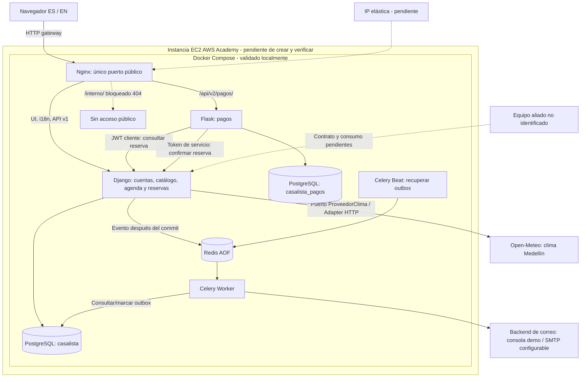
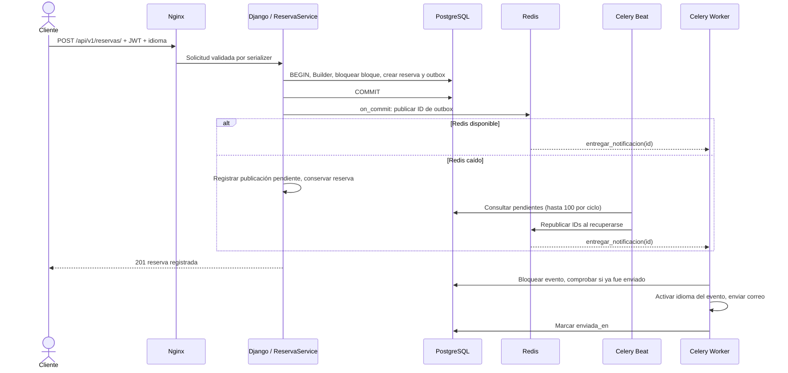
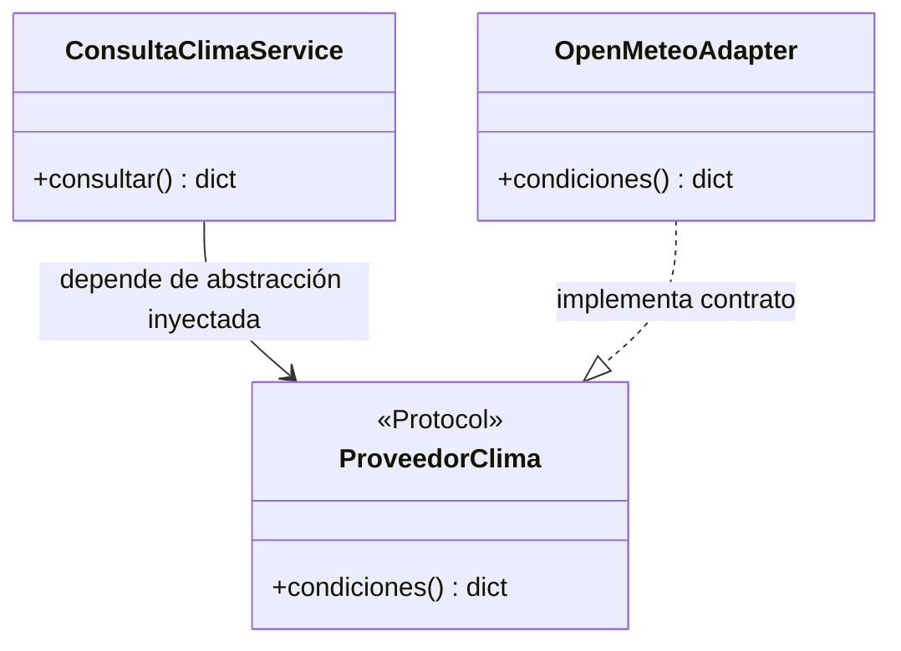

# Arquitectura de Entrega 2

Estado: implementada y probada en Docker local. AWS es el destino planificado;
no se representa como despliegue existente. Base auditada: main d359099.

Django y Flask siguen siendo imágenes y procesos independientes. El gateway
resuelve nombres de servicio con el DNS de Docker; no fija IPs de contenedores.
Las dos bases comparten servidor y usuario (deuda heredada de aislamiento de
permisos). No existe una transacción distribuida entre pagos y reservas.

## Strangler

Se conserva la extracción original del módulo pagos. El tráfico de la interfaz
en Compose usa `/api/v2/pagos/`; las demás funcionalidades permanecen en Django.
`/api/v1/pagos/` se conserva para compatibilidad y pagos históricos. No se copian,
truncan ni eliminan datos. Un rollback de aplicación debe considerar que los
pagos v2 siguen en su propia base: cambiar URL_PAGOS no migra esos registros.

Los cobros de demo son SIMULADOS. Las implementaciones TARJETA y PSE heredadas
no son proveedores financieros reales. El requisito de tercero se satisface por
Open-Meteo con HTTP real, separado de los pagos.

## Reserva y evento asíncrono

La semántica de entrega es **al menos una vez**. Si el backend de correo acepta
el envío y el worker muere antes de guardar enviada_en, puede repetirse el
correo; no se promete exactly-once. Una vez marcada la entrega, los mensajes
duplicados no se vuelven a enviar. Las excepciones de correo reintentan con
espera creciente, y Beat vuelve a publicar pendientes. La consola solo prueba
el procesamiento: no demuestra recepción en una cuenta de correo real.

## Adapter y DIP

El caso de uso no importa `requests` ni conoce la URL externa. La composición
ocurre en la vista. El adaptador traduce campos/unidades, rechaza esquemas
inválidos, evita redirecciones y limita tiempos de conexión/lectura. Se almacena
la respuesta válida cinco minutos en caché local por proceso. Una caída externa
responde JSON 503; la búsqueda, reserva y pago no dependen del clima. Las
coordenadas son las de la ciudad: no se transmiten direcciones de los clientes.

## Internacionalización y UX

LocaleMiddleware aplica preferencia de cookie o Accept-Language. Templates y
mensajes del servidor usan gettext; JavaScriptCatalog entrega djangojs; Flask
carga el catálogo gettext por idioma de petición. Los códigos JSON, valores de
estado y categorías permanecen estables; solo se traducen etiquetas. Los
nombres y descripciones escritos por usuarios se muestran en su idioma original.
El evento guarda el idioma de la reserva para conservarlo al ejecutar Celery.

La interfaz incorpora identidad visual, jerarquía, diseño adaptable, salto al
contenido, etiquetas, navegación por teclado, validación de email/obligatorios,
prevención de clics repetidos, errores de red, confirmación de cancelación,
paginación y escape de texto externo al insertarlo en HTML.

## Bono >70%

No se reclama. Pagos es el único módulo de negocio migrado a Flask. Worker y
Beat no convierten por sí solos las reglas Django en microservicios. Para el
bono se requiere definir un denominador de casos de uso, inventariar la lógica
y demostrar independencia funcional >70%; no contar contenedores ni líneas de
código como sustituto. La prioridad actual es cerrar aliado, AWS y evidencias.
