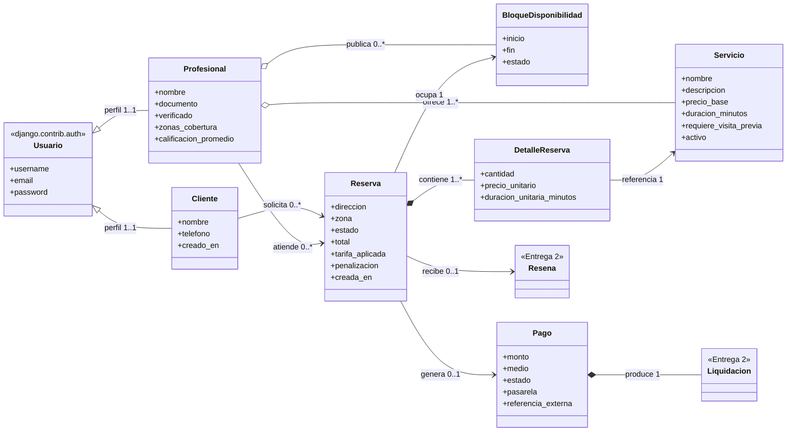

# 01 · Modelo de Dominio

## Alcance de la entrega

El diagrama de clases de la Actividad 1 define **10 clases de dominio**. Esta
entrega implementa **8 de las 10 (80 %)**, por encima del 50–60 % exigido.

| Clase del diagrama | Módulo | Estado | Dónde está |
|---|---|---|---|
| `Usuario` (abstracta) | Cuentas | Implementada | `django.contrib.auth.User` + perfiles |
| `Cliente` | Cuentas | Implementada | `apps/cuentas/models.py` |
| `Profesional` | Cuentas | Implementada | `apps/cuentas/models.py` |
| `Servicio` | Catálogo | Implementada | `apps/catalogo/models.py` |
| `BloqueDisponibilidad` | Agenda | Implementada | `apps/reservas/models.py` |
| `Reserva` | Reservas | Implementada | `apps/reservas/models.py` |
| `DetalleReserva` | Reservas | Implementada | `apps/reservas/models.py` |
| `Pago` | Pagos | **Nueva en esta entrega** | `apps/pagos/models.py` |
| `Liquidación` | Pagos | Entrega 2 | — |
| `Reseña` | Reputación | Entrega 2 | — |

### Por qué se agregó `Pago` y no otra clase

Las tres clases pendientes al terminar el Taller 01 eran `Pago`, `Liquidación`
y `Reseña`. Se eligió `Pago` porque es la única que el **flujo núcleo**
necesita: la sección 1.5 del Business Case describe el ciclo
`reserva → pago → confirmación → liquidación`, y sin `Pago` la reserva se
queda para siempre en `PENDIENTE`. La regla RN-03 ("una reserva solo puede
confirmarse si existe un pago aprobado") era literalmente inimplementable.

`Liquidación` y `Reseña` se quedan fuera porque son *posteriores* al flujo de
venta: ninguna de las dos bloquea nada. Es la misma prioridad que señala la
sección 3 del Business Case, donde Reputación aparece como el módulo más
desacoplado y por tanto el último en importar.

---

## Diagrama implementado



Las multiplicidades son las del documento de dominio. Las dos clases con
estereotipo `<<Entrega 2>>` se dibujan para mostrar que el modelo sigue
completo; no existen en el código.

---

## Cómo se tradujo la herencia `Usuario`

El diagrama tiene `Usuario` como clase abstracta con `Cliente` y `Profesional`
heredando de ella. En Django hay tres formas de traducir eso, y se eligió la
tercera:

| Opción | Por qué no / por qué sí |
|---|---|
| Heredar `AbstractUser` en `Cliente` y `Profesional` | Django solo admite **un** modelo de usuario por proyecto. Habría que elegir uno de los dos roles como "el usuario real". |
| Un `AbstractUser` con un campo `rol` | Mezcla los datos de los dos roles en una tabla: `Profesional` necesita `documento` y `verificado`, `Cliente` no. Quedan columnas nulas por diseño. |
| **`User` de Django + un perfil por rol (`OneToOne`)** | Es lo que se hizo. Cada perfil tiene solo sus propios campos, y una misma persona puede ser cliente hoy y profesional después sin duplicar cuenta. |

La consecuencia práctica se ve en `GET /api/v1/cuentas/perfil/`: la respuesta
trae `cliente` y `profesional` por separado, y cualquiera de los dos puede
venir en `null`.

---

## Dónde quedó cada método del diagrama

El enunciado de la entrega advierte:

> Cualquier rastro de lógica de negocio (cálculos, validaciones de inventario,
> etc.) dentro de un archivo `views.py` o en métodos de un `Model` que no sean
> de persistencia, penalizará la nota de la sección SOLID en un 50 %.

En el Taller 01 los modelos tenían comportamiento. En esta entrega **se sacó
todo**. Los modelos quedaron con campos, `Meta`, restricciones de base de
datos y `__str__`; nada más.

| Método del diagrama | Estaba en (Taller 01) | Está en (Entrega 1) |
|---|---|---|
| `Profesional.cubreZona()` | `models.Profesional` | `cuentas/dominio/cobertura.py` → `PoliticaDeCobertura` |
| `Servicio.calcularPrecio()` | `models.Servicio` | `catalogo/dominio/precios.py` → `CalculadoraDeServicio` |
| `BloqueDisponibilidad.estaLibre()` | `models.BloqueDisponibilidad` | `reservas/dominio/agenda.py` → `ReglasAgenda` |
| `BloqueDisponibilidad.ocupar()` | `models.BloqueDisponibilidad` | `reservas/dominio/agenda.py` → `ReglasAgenda` |
| `BloqueDisponibilidad.seSolapaCon()` | `models.BloqueDisponibilidad` | `reservas/dominio/agenda.py` → `ReglasAgenda` |
| `Reserva.calcularTotal()` | `models.Reserva` | `reservas/dominio/precios.py` → `CalculadoraDeReserva` |
| `Reserva.confirmar()` / `cancelar()` | no existía | `reservas/dominio/ciclo_de_vida.py` → `CicloDeVidaReserva` |
| `Reserva.calcularPenalizacion()` | no existía | `reservas/dominio/cancelacion.py` → `PoliticaDeCancelacionEstandar` |
| `DetalleReserva.calcularSubtotal()` | `models.DetalleReserva` | `reservas/dominio/precios.py` → `CalculadoraDeReserva` |
| `DetalleReserva.duracionTotal()` | `models.DetalleReserva` | `reservas/dominio/precios.py` → `CalculadoraDeReserva` |
| `Pago.procesar()` / `estaAprobado()` | no existía | `pagos/services.py` → `PagoService` |

### Qué se gana con eso

No es solo cumplir el enunciado. Hay un beneficio concreto y medible: **las
reglas se pueden probar sin base de datos**.

`apps/cuentas/tests/test_cuentas.py` prueba RN-07 contra un objeto de tres
líneas:

```python
class ProfesionalFalso:
    def __init__(self, zonas, verificado=True):
        self.zonas_cobertura = zonas
        self.verificado = verificado

# Esta prueba hereda de SimpleTestCase: no crea base de datos.
def test_la_comparacion_ignora_mayusculas(self):
    profesional = ProfesionalFalso("Laureles,Belen")
    self.assertTrue(PoliticaDeCobertura.cubre_zona(profesional, "laureles"))
```

Si `cubre_zona()` estuviera dentro del modelo, esta prueba necesitaría crear
un `User`, un `Profesional` y una transacción de base de datos para comprobar
una comparación de cadenas. La suite completa corre en **0,6 segundos** en
buena parte por esta decisión.

---

## Qué sí quedó en los modelos

Los modelos conservan lo que es responsabilidad de la capa de persistencia:

```python
class BloqueDisponibilidad(models.Model):
    class Meta:
        constraints = [
            models.CheckConstraint(
                condition=models.Q(fin__gt=models.F("inicio")),
                name="bloque_termina_despues_de_empezar",
            ),
            models.UniqueConstraint(
                fields=["profesional", "inicio", "fin"],
                name="bloque_unico_por_profesional",
            ),
        ]
```

Esto **no es lógica de negocio en el modelo**: es una restricción de
integridad que ejecuta el motor de base de datos. La diferencia es quién la
evalúa. Una regla escrita en Python la cumple el proceso que la ejecuta; una
restricción declarada aquí la cumple la base de datos aunque escriban dos
procesos a la vez, o aunque alguien inserte una fila desde el admin.

Es una decisión deliberada: las reglas que **no pueden** romperse nunca se
declaran en los dos sitios (dominio y base de datos), y las que dependen de
comparar varias entidades viven solo en el dominio.

---

## Limitaciones conocidas

Documentarlas es parte del trabajo. Estas son las decisiones que se tomaron a
sabiendas de que no son la solución final:

| Limitación | Por qué se aceptó | Cómo se resuelve |
|---|---|---|
| `zonas_cobertura` es texto separado por comas | Normalizarlo agregaría una clase que no está en el diagrama | Tabla `ZonaCobertura` con M2M. La política `PoliticaDeCobertura` no cambiaría: solo cambia de dónde saca la lista |
| El solapamiento de franjas se valida en Python, no en la base de datos | No existe una restricción portable de rangos; PostgreSQL la tiene (`EXCLUDE USING gist`), SQLite no | Migración específica de PostgreSQL cuando se abandone SQLite |
| Un pago rechazado bloquea el reintento | La relación `Reserva → Pago` es `0..1` según el diagrama | Modelar `IntentoDePago` como entidad aparte en la Entrega 2 |
| `PasarelaPSE` responde en la misma petición | PSE real confirma por webhook minutos después | Estado `PENDIENTE` + endpoint de webhook en la Entrega 2 |
| `calificacion_promedio` nunca se actualiza | Depende de `Reseña`, que es de la Entrega 2 | Servicio `RecalculoCalificacionService` en el módulo Reputación |

Las tres primeras tienen una prueba que las documenta, para que cuando se
resuelvan quede claro qué comportamiento cambió.
