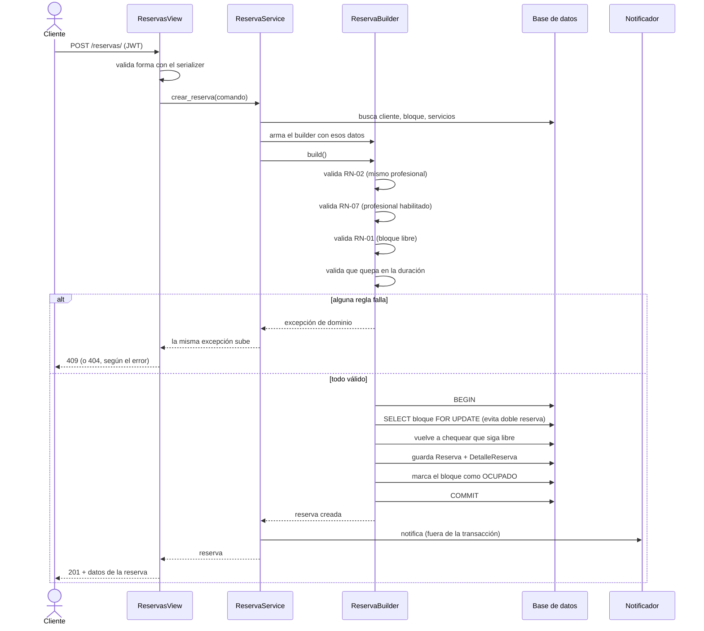

# Diagrama de secuencia — Crear reserva

Es el flujo más complejo del sistema: `POST /api/v1/reservas/`. Pasa por la
vista, el service, el Builder (que valida todo) y hace la escritura dentro de
una transacción.

Dos cosas para explicar en la sustentación si preguntan:

- **El `SELECT FOR UPDATE`** es porque, entre que se valida que el bloque está
  libre y se guarda la reserva, otro cliente podría estar reservando la misma
  franja al mismo tiempo. Se vuelve a chequear ya con el bloqueo puesto.
- **La notificación va fuera de la transacción** para no tener la fila
  bloqueada mientras se manda un correo (que puede demorarse).

El código de esta parte está en `apps/reservas/dominio/reserva_builder.py`.
