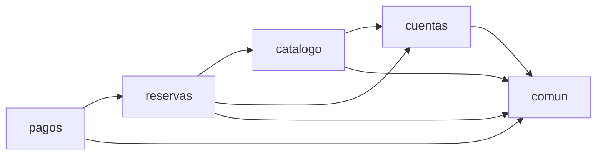

# 02 · Estructura del Proyecto

## El árbol

```
casalista/
├── manage.py
├── requirements.txt
├── .env.example
│
├── config/                     # configuración del proyecto, no del negocio
│   ├── settings.py
│   ├── urls.py                 # tabla de rutas raíz: /api/v1/<módulo>/
│   ├── wsgi.py
│   └── asgi.py
│
├── apps/
│   ├── comun/                  # núcleo compartido — NO es una app de Django
│   │   ├── dominio/
│   │   │   ├── dinero.py              # normalización monetaria
│   │   │   └── excepciones.py         # jerarquía base de errores
│   │   ├── infraestructura/
│   │   │   └── factory.py             # base de las tres Factories
│   │   ├── api/
│   │   │   ├── manejador_errores.py   # dominio → HTTP, un solo punto
│   │   │   ├── middleware.py          # X-Request-ID
│   │   │   ├── paginacion.py
│   │   │   ├── serializers.py
│   │   │   └── views.py               # /salud/
│   │   └── pruebas.py                 # fábrica de datos y dobles
│   │
│   ├── cuentas/                # módulo Cuentas
│   ├── catalogo/               # módulo Catálogo
│   ├── reservas/               # módulo Agenda y Reservas
│   └── pagos/                  # módulo Pagos
│
└── docs/wiki/
```

Cada app del negocio tiene exactamente la misma estructura interna:

```
apps/reservas/
├── models.py               # solo datos y restricciones de integridad
├── dto.py                  # comandos (dataclasses inmutables)
├── services.py             # Service Layer: una clase por flujo
├── admin.py
├── migrations/
│
├── dominio/                # reglas de negocio. No importa nada de Django REST
│   ├── excepciones.py
│   ├── puertos.py          # interfaces que el dominio necesita del exterior
│   ├── agenda.py           # ReglasAgenda
│   ├── precios.py          # CalculadoraDeReserva
│   ├── tarifas.py          # estrategias de tarifa
│   ├── ciclo_de_vida.py    # máquina de estados de la reserva
│   ├── cancelacion.py      # política RN-04
│   └── reserva_builder.py  # ← el Builder
│
├── infraestructura/        # implementaciones concretas de los puertos
│   ├── notificaciones.py
│   └── factories.py
│
├── api/                    # capa de presentación
│   ├── serializers.py
│   ├── views.py            # APIView
│   └── urls.py
│
└── tests/
```

---

## Las tres decisiones que definen esta estructura

### 1. Una app de Django por módulo del dominio

La sección 3 del Business Case ya había agrupado las clases en cuatro módulos
"que cambian por las mismas razones". Esa agrupación no se inventó para el
código: **el código la respeta**.

| Módulo del Business Case | App de Django | Clases |
|---|---|---|
| Cuentas y Catálogo | `cuentas` + `catalogo` | Usuario, Cliente, Profesional / Servicio |
| Agenda y Reservas | `reservas` | BloqueDisponibilidad, Reserva, DetalleReserva |
| Pagos y Liquidación | `pagos` | Pago |
| Reputación | — | Entrega 2 |

**La única desviación**: el Business Case agrupa "Cuentas y Catálogo" en un
solo módulo y aquí son dos apps. La razón es que cambian por motivos
distintos y se leen con frecuencias muy distintas. El catálogo es el endpoint
más consultado del sistema —todo el mundo busca antes de reservar— y es el
primer candidato a ponerse detrás de una cache o a replicarse. La identidad de
los usuarios no tiene ese perfil. Tenerlos separados es lo que permite tomar
esa decisión después sin tocar el módulo de cuentas.

#### La dirección de las dependencias

Las apps están declaradas en `settings.py` en el orden en que dependen unas de
otras, y ese orden se respeta:

```
cuentas   →  no importa nada de las otras apps
catalogo  →  importa cuentas
reservas  →  importa cuentas y catalogo
pagos     →  importa reservas
```



No hay un solo ciclo. Se puede comprobar leyendo los `import` de cualquier
archivo: `apps/cuentas/` nunca escribe `from apps.reservas...`.

Esto es lo que hace realista la afirmación del Business Case de que
"Reputación es el candidato natural a extraerse primero, y Pagos el segundo":
`pagos` es una hoja del grafo. Extraerlo significa reemplazar dos `import` por
dos llamadas HTTP, no reescribir el sistema.

### 2. `comun` no es una app de Django

Es un paquete Python normal, sin `models.py` ni entrada en `INSTALLED_APPS`.
La distinción es intencional: **`comun` no tiene dominio propio**. Contiene lo
que las cuatro apps necesitan compartir:

- `dinero.py` — todas las apps calculan plata y todas tienen que redondear
  igual. Está en `dominio/` y no en un `utils.py` porque redondear a dos
  decimales con HALF_UP es una decisión del negocio, no un detalle técnico.
- `excepciones.py` — la jerarquía base. Cada app hereda de ella para que el
  manejador central pueda traducir todos los errores con un solo `isinstance`.
- `factory.py` — el mecanismo que comparten las tres Factories.
- `manejador_errores.py`, `middleware.py`, `paginacion.py` — infraestructura
  de la API que no pertenece a ningún módulo.

Si `comun` empezara a crecer con reglas de negocio, sería la señal de que una
regla está en el sitio equivocado.

### 3. Las carpetas nombran capas, no tipos de archivo

Dentro de una app, `dominio/`, `infraestructura/` y `api/` corresponden a las
tres capas de la arquitectura hexagonal:

| Carpeta | Capa | Qué puede importar |
|---|---|---|
| `dominio/` | núcleo | `models`, otras clases de dominio, `comun/dominio` |
| `services.py` | aplicación | `dominio/`, `models`, `dto`, las Factories |
| `infraestructura/` | adaptadores | los puertos de `dominio/`, librerías externas |
| `api/` | presentación | `services.py`, `dto`, sus serializers |

La regla que sostiene todo: **`dominio/` nunca importa de `infraestructura/`**.
El dominio declara puertos (interfaces) y la infraestructura los implementa.
Se puede verificar:

```bash
grep -rn --include="*.py" "^from .*infraestructura" apps/*/dominio/
# no devuelve nada: el dominio no conoce ni un solo adaptador
```

---

## Alternativas que se descartaron

Vale la pena decir qué NO se hizo y por qué, porque la estructura elegida solo
se entiende comparada.

### Una sola app con `models.py`, `views.py`, `serializers.py`

Es la estructura por defecto de Django. Se descartó porque agrupa por *tipo de
archivo* en vez de por *módulo del negocio*: un cambio en la política de
precios tocaría `models.py`, `services.py` y `serializers.py`, tres archivos
enormes compartidos con todo lo demás. Y hace imposible extraer un módulo:
no hay ninguna frontera que cortar.

### Capas globales: `domain/`, `application/`, `infrastructure/` en la raíz

Es la estructura de Clean Architecture "de manual". Se descartó porque agrupa
por capa antes que por módulo, y eso rompe justamente lo que la sección 3 del
Business Case quería preservar: para extraer `pagos` habría que ir a buscar
sus pedazos en tres carpetas distintas. Aquí `apps/pagos/` es una carpeta que
se puede mover completa.

### Un Repository sobre el ORM

Un `ReservaRepository` que envuelva el `QuerySet` es lo que recomienda el
patrón Repository. Se descartó, y esta es la decisión más discutible de todas:

- El `QuerySet` de Django **ya es** un Repository: encapsula el acceso, es
  componible y es sustituible en pruebas.
- Envolverlo agregaría una capa de métodos que solo reenvían llamadas
  (`obtener_por_id`, `listar_por_cliente`), sin ninguna decisión propia.
- El beneficio real de un Repository —poder cambiar de motor de persistencia—
  ya lo da el ORM.

Lo que **sí** se aisló es lo que un Repository aporta de verdad aquí: la
traducción de `DoesNotExist` a excepciones del dominio. Cada servicio tiene sus
métodos `_obtener_x()`, y de esa frontera hacia arriba nadie vuelve a ver una
excepción de Django:

```python
@staticmethod
def _obtener_bloque(bloque_id: int) -> BloqueDisponibilidad:
    try:
        return BloqueDisponibilidad.objects.select_related("profesional").get(pk=bloque_id)
    except BloqueDisponibilidad.DoesNotExist:
        raise BloqueNoEncontrado(...) from None
```

Si el proyecto creciera al punto de necesitar dos orígenes de datos distintos
para la misma entidad, ahí sí valdría introducir el Repository. Hoy sería
complejidad sin beneficio.
