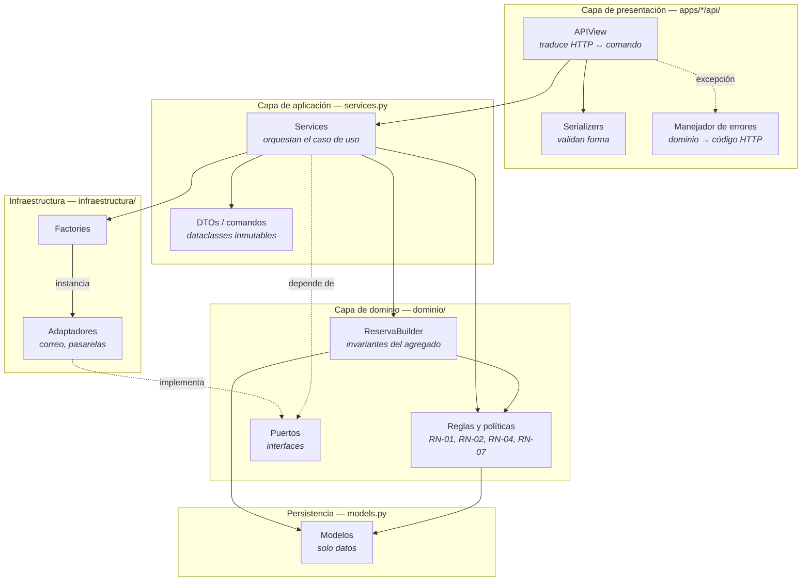

# 03 · Arquitectura por Capas

## El mapa



Las flechas punteadas son las que importan: el servicio depende del **puerto**,
no del adaptador. La flecha entre adaptador y puerto va hacia arriba, no hacia
abajo. Eso es la inversión de dependencias, dibujada.

---

## Qué hace cada capa (y qué tiene prohibido)

| Capa | Responsabilidad | Prohibido |
|---|---|---|
| **Presentación** (`api/`) | leer el request, validar la forma, elegir el código de estado | reglas, consultas al ORM, `try/except` de negocio |
| **Aplicación** (`services.py`) | resolver ids → entidades, orquestar los pasos, controlar la transacción | validar reglas, conocer HTTP, instanciar clases concretas |
| **Dominio** (`dominio/`) | todas las reglas del Business Case | conocer HTTP, importar de `infraestructura/` |
| **Infraestructura** | hablar con el mundo exterior | conocer casos de uso |
| **Persistencia** (`models.py`) | guardar y declarar restricciones | calcular, validar, decidir |

---

## Una vista completa

Este es el POST más complejo del sistema: crear una reserva. Dispara el
Builder, dos Factories, siete validaciones de negocio y una transacción con
bloqueo de fila.

```python
class ReservasView(APIView):
    permission_classes = [IsAuthenticated]
    servicio_creacion = ReservaService

    def post(self, request):
        entrada = CrearReservaSerializer(data=request.data)
        entrada.is_valid(raise_exception=True)
        reserva = self.servicio_creacion().crear_reserva(
            entrada.a_comando(request.user.pk)
        )
        return Response(ReservaSerializer(reserva).data, status=status.HTTP_201_CREATED)
```

Cinco líneas. La vista no sabe:

- que existe un Builder;
- que hay dos estrategias de tarifa y cuál se está usando;
- que la agenda se bloquea con `select_for_update`;
- que se manda una notificación;
- qué es RN-01, RN-02 ni RN-07.

Lo único que sabe es: *valida la forma, delega, responde 201*.

### Dónde está el `try/except`

En ninguna vista del proyecto. Está una sola vez, en
`apps/comun/api/manejador_errores.py`, registrado en `settings.py`:

```python
REST_FRAMEWORK = {
    "EXCEPTION_HANDLER": "apps.comun.api.manejador_errores.manejar_excepcion",
}
```

```python
def manejar_excepcion(excepcion, contexto):
    if isinstance(excepcion, ErrorDeDominio):
        return Response({"error": excepcion.como_diccionario()},
                        status=excepcion.estado_http)
    ...
```

Cada excepción del dominio lleva encima su propio código HTTP:

```python
class ReglaDeNegocioViolada(ErrorDeDominio):
    codigo = "RN-000"
    estado_http = 409

class BloqueNoDisponible(ReglaDeNegocioViolada):
    codigo = "RN-01"
    mensaje_por_defecto = "La franja horaria ya fue tomada."
```

Agregar una regla nueva de negocio no toca la capa de API: se escribe la
excepción en `dominio/excepciones.py` y sale por HTTP con su código correcto
automáticamente.

Además, **todos los errores tienen la misma forma**, vengan del dominio o de
un serializer de DRF. Hay una prueba que lo garantiza
(`test_todos_los_errores_tienen_la_misma_forma`).

---

## El Service Layer

Hay **nueve servicios** en el proyecto, uno por flujo de negocio:

| App | Servicio | Caso de uso |
|---|---|---|
| cuentas | `RegistroClienteService` | una persona se registra como cliente |
| cuentas | `RegistroProfesionalService` | una persona se registra como profesional |
| cuentas | `ConsultaPerfilService` | resolver el perfil de la cuenta autenticada |
| catalogo | `CatalogoService` | explorar la oferta (RN-07) |
| reservas | `AgendaService` | el profesional publica y consulta franjas |
| reservas | `ReservaService` | el cliente crea una reserva |
| reservas | `ConsultaReservasService` | el cliente lee sus reservas |
| reservas | `CancelacionReservaService` | el cliente cancela (RN-01, RN-04) |
| pagos | `PagoService` | el cliente paga y la reserva se confirma (RN-03) |

### Por qué crear y cancelar son dos servicios y no dos métodos

Es la aplicación directa del Principio de Responsabilidad Única. Un solo
`ReservaService` con `crear()` y `cancelar()` habría acabado dependiendo de
todo a la vez: de la tarifa, del notificador, de la política de cancelación y
del ciclo de vida. Separados, cada uno declara solo lo que usa:

```python
class ReservaService:
    def __init__(self, notificador=None, calculador_tarifa=None, builder_factory=ReservaBuilder):
        ...

class CancelacionReservaService:
    def __init__(self, politica=None, consultas=None):
        ...
```

Se lee en la firma del constructor: **crear** necesita notificador y tarifa;
**cancelar** necesita la política de RN-04. Si mañana cambia la política de
cancelación, `ReservaService` no se entera.

### Inyección de dependencias con valor por defecto

Todos los servicios reciben sus colaboradores por constructor, y si no se los
dan se los piden a la Factory:

```python
self.notificador = notificador or NotificadorFactory.crear()
self.calculador_tarifa = calculador_tarifa or CalculadorTarifaFactory.crear()
```

Este patrón resuelve dos necesidades opuestas a la vez:

- **En producción**: `ReservaService()` funciona sin configurar nada; el
  entorno decide las implementaciones.
- **En pruebas**: se inyecta un doble y ni se consulta el entorno.

```python
espia = NotificadorEspia()
servicio = ReservaService(notificador=espia, calculador_tarifa=TarifaBase())
reserva = servicio.crear_reserva(comando)

self.assertEqual(espia.avisos, [reserva.pk])
```

Sin esto, comprobar que se notifica exigiría interceptar el envío de correo o
manipular variables de entorno dentro de la prueba.

---

## SOLID, con la línea de código al lado

### S — Responsabilidad Única

El caso más claro es lo que pasó con el Taller 01. `BloqueDisponibilidad`
tenía cinco responsabilidades: guardarse, decir si estaba libre, ocuparse,
calcular su duración y detectar solapamientos. Hoy guarda; `ReglasAgenda`
decide.

Se nota en las razones para cambiar cada archivo: `models.py` cambia si cambia
el esquema de datos, `agenda.py` cambia si cambia la definición de "libre".
Antes, ambos cambios tocaban el mismo archivo.

### O — Abierto/Cerrado

Agregar una tercera estrategia de tarifa (por ejemplo, una promocional):

```python
# 1. dominio/tarifas.py — clase nueva
class TarifaPromocional(TarifaBase):
    nombre = "PROMOCIONAL"
    def calcular(self, detalles, bloque):
        return a_dinero(super().calcular(detalles, bloque) * Decimal("0.85"))

# 2. infraestructura/factories.py — una línea en el registro
registro = {
    "BASE": TarifaBase,
    "DINAMICA": TarifaDinamica,
    "PROMOCIONAL": TarifaPromocional,   # ← esto es todo
}
```

Cero cambios en `views.py`, `services.py`, `reserva_builder.py` o
`serializers.py`. El registro como diccionario en lugar de `if/elif` es lo que
hace posible esto.

### L — Sustitución de Liskov

Hay una prueba que lo comprueba explícitamente para todas las variantes
registradas:

```python
def test_todo_lo_que_devuelve_cumple_el_puerto(self):
    for tipo in NotificadorFactory.opciones():
        self.assertIsInstance(NotificadorFactory.crear(tipo), Notificador)
```

Y en la práctica: `NotificadorEspia` (que solo guarda una lista) se le pasa a
`ReservaService` en lugar de `NotificadorEmail` y el servicio funciona igual.

### I — Segregación de Interfaces

Los cuatro puertos del proyecto tienen **un método cada uno**:

| Puerto | Método |
|---|---|
| `Notificador` | `enviar_confirmacion_reserva(reserva)` |
| `CalculadorTarifa` | `calcular(detalles, bloque)` |
| `PoliticaDeCancelacion` | `calcular_penalizacion(reserva, momento)` |
| `PasarelaDePago` | `cobrar(monto, referencia_interna)` |

Un `ServiciosExternos` con los cuatro métodos habría obligado a
`NotificadorConsola` a implementar `cobrar()`.

### D — Inversión de Dependencias

`PagoService` es el ejemplo más completo. Cobra dinero sin conocer ninguna
pasarela:

```python
from apps.pagos.dominio.puertos import PasarelaDePago   # ← el puerto

class PagoService:
    def __init__(self, pasarela: PasarelaDePago | None = None, ...):
        self.pasarela = pasarela
```

En todo `services.py` no aparece `PasarelaTarjeta` ni `PasarelaPSE`. Solo la
Factory las conoce.

---

## Concurrencia: cómo se sostiene RN-01

Es el atributo de calidad número uno del Business Case: *"dos clientes no
pueden reservar el mismo bloque del mismo profesional"*.

El problema es una condición de carrera clásica:

```
Petición A                        Petición B
─────────────────────────────────────────────────────
lee bloque 7 → LIBRE
                                  lee bloque 7 → LIBRE
guarda reserva, ocupa el 7
                                  guarda reserva, ocupa el 7   ← doble venta
```

Comprobar `esta_libre()` antes de guardar **no basta**: entre la comprobación
y el guardado hay una ventana.

La solución está dentro de `build()`:

```python
def build(self) -> Reserva:
    self._validar()                       # validación optimista, sin bloquear
    detalles = self._construir_detalles()

    with transaction.atomic():
        # Se relee el bloque BAJO BLOQUEO y se vuelve a validar.
        self._bloque = BloqueDisponibilidad.objects.select_for_update().get(
            pk=self._bloque.pk
        )
        ReglasAgenda.exigir_disponible(self._bloque)
        ...
```

La primera validación es barata y rechaza el 99 % de los casos malos sin
bloquear nada. La segunda ocurre con la fila bloqueada: la petición B se
queda esperando en el `select_for_update()` hasta que A hace commit, y cuando
por fin lee, el bloque ya está `OCUPADO`. Recibe un 409.

`exigir_disponible` comprueba **dos** fuentes y no una:

```python
if not cls.esta_libre(bloque):                 # el campo estado (el resumen)
    raise BloqueNoDisponible(...)
ya_reservado = Reserva.objects.filter(         # la tabla de reservas (la verdad)
    bloque=bloque, estado__in=ESTADOS_QUE_OCUPAN_AGENDA
).exists()
```

Si por cualquier razón las dos se desincronizaran, el sistema falla cerrando
—rechaza la reserva— en vez de vender dos veces la misma franja.

### Limitación honesta

`select_for_update()` **no hace nada en SQLite**, que es el motor por defecto
del proyecto. En SQLite la protección real es que el motor serializa las
escrituras. Por eso `settings.py` trae la configuración de PostgreSQL lista:

```bash
DB_ENGINE=postgres
```

Y no es un detalle menor: es la razón por la que un despliegue de producción de
CasaLista **tiene** que usar PostgreSQL.

---

## Transacciones: quién las abre y por qué

| Operación | Quién abre la transacción | Por qué ahí |
|---|---|---|
| Crear reserva | `ReservaBuilder.build()` | La reserva, sus detalles y el bloque ocupado son un agregado: se guardan juntos o no se guardan. Quien conoce esa invariante es el Builder |
| Cancelar | `CancelacionReservaService` | Cancelar y liberar la franja son un solo hecho de negocio (RN-01), pero es orquestación entre dos entidades |
| Pagar | `PagoService._registrar_aprobacion()` | Guardar el pago y confirmar la reserva son un solo hecho (RN-03) |
| Registrar cuenta | `RegistroClienteService` | Un `User` sin perfil podría autenticarse y no poder reservar nada |

### Qué queda deliberadamente FUERA de la transacción

Dos cosas, y por la misma razón:

```python
reserva = builder.build()                             # transacción cerrada
self.notificador.enviar_confirmacion_reserva(reserva) # ← fuera
```

```python
resultado = pasarela.cobrar(...)                      # ← fuera
with transaction.atomic():                            # transacción después
    pago = Pago.objects.create(...)
```

Ambas son llamadas de red que pueden tardar segundos. Mantenerlas dentro
alargaría el bloqueo de la fila del bloque y degradaría toda la agenda bajo
carga. Y en el caso de la notificación hay una razón de negocio además:
**una notificación caída no puede tumbar una reserva ya guardada**. Ese
contrato está escrito en el puerto:

```python
class Notificador(ABC):
    @abstractmethod
    def enviar_confirmacion_reserva(self, reserva) -> None:
        """Contrato: no debe lanzar excepciones. Una notificación que falla no
        puede tumbar una reserva que ya se guardó."""
```

---

## Cómo se verifica todo esto

```bash
python manage.py test
# Ran 127 tests in 0.610s — OK
```

| Qué se prueba | Archivo | Pruebas |
|---|---|---|
| Reglas del dominio (Builder) | `reservas/tests/test_reserva_builder.py` | 16 |
| Orquestación de los servicios | `reservas/tests/test_services.py` | 19 |
| Códigos HTTP de la API | `reservas/tests/test_api.py` | 25 |
| Factories | `reservas/tests/test_factories.py` | 12 |
| Pagos (RN-03) | `pagos/tests/test_pagos.py` | 14 |
| Cobertura (RN-07) y registro | `cuentas/tests/test_cuentas.py` | 15 |
| Catálogo | `catalogo/tests/test_catalogo.py` | 15 |
| Núcleo compartido | `comun/test_comun.py` | 11 |

Que la suite tarde menos de un segundo no es casualidad: la mayoría de las
pruebas de dominio heredan de `SimpleTestCase` y no tocan la base de datos,
precisamente porque las reglas salieron de los modelos.
