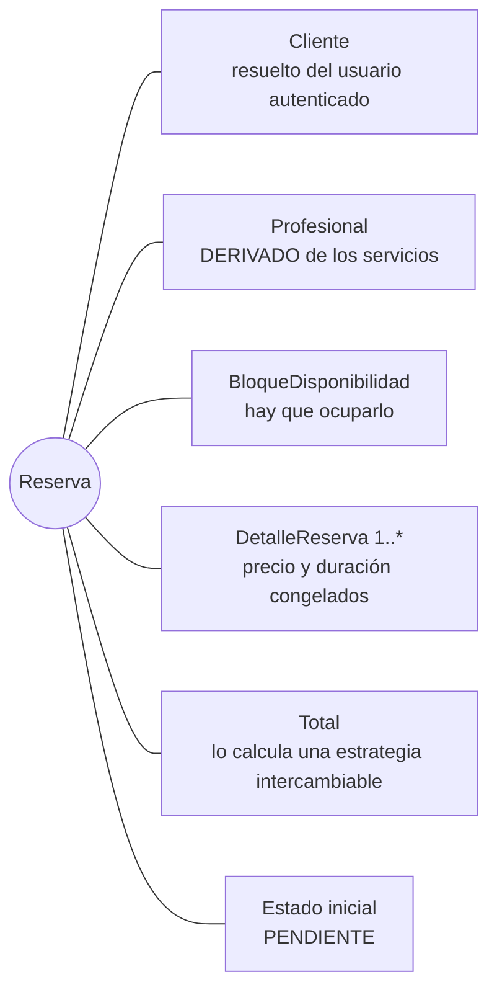
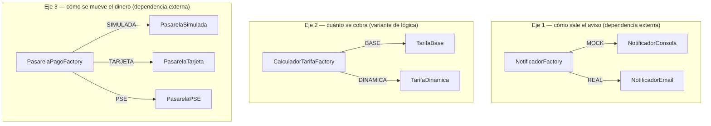

# 04 · Patrones Creacionales

| Patrón | Dónde | Qué resuelve |
|---|---|---|
| **Builder** | `apps/reservas/dominio/reserva_builder.py` | Construir `Reserva`, la entidad más compleja del sistema |
| **Factory** | `apps/reservas/infraestructura/factories.py` | `NotificadorFactory` — dependencia externa (correo) |
| **Factory** | `apps/reservas/infraestructura/factories.py` | `CalculadorTarifaFactory` — variante de lógica (precio) |
| **Factory** | `apps/pagos/infraestructura/factories.py` | `PasarelaPagoFactory` — dependencia externa (pasarela de pago) |

---

# Builder — `ReservaBuilder`

## Por qué `Reserva` es la entidad más compleja

No es una afirmación cómoda: es lo que se necesita para que exista una
`Reserva` válida.



Y las reglas que tienen que cumplirse **todas a la vez**:

| # | Regla | De dónde sale |
|---|---|---|
| 1 | Hay cliente, franja, dirección y zona | estructural |
| 2 | Hay al menos un servicio y cada cantidad es positiva | estructural |
| 3 | Ningún servicio está dado de baja | Catálogo |
| 4 | Todos los servicios son del mismo profesional | **RN-02** |
| 5 | El profesional está verificado y cubre la zona | **RN-07** |
| 6 | La franja es del mismo profesional | **RN-01** |
| 7 | La franja está libre y sin reserva activa | **RN-01** |
| 8 | Los servicios caben en la duración de la franja | derivada de RN-01 |

Compárese con las demás entidades: `Servicio` es un formulario; `Pago` copia
un monto y llama a una pasarela; `Cliente` son tres campos. `Reserva` es la
única que es un **agregado**: tres tablas que se escriben en una sola
transacción y que deben quedar consistentes entre sí.

## Qué pasaría sin el Builder

```python
# Sin Builder — todo esto tendría que estar en el Service
reserva = Reserva.objects.create(
    cliente=cliente,
    profesional=servicios[0].profesional,      # ¿y si los servicios son de dos?
    bloque=bloque,                             # ¿y si el bloque es de otro?
    total=???,                                 # ¿quién suma? ¿con qué tarifa?
    ...
)
for servicio, cantidad in lineas:
    DetalleReserva.objects.create(
        reserva=reserva,
        precio_unitario=servicio.precio_base,  # ¿alguien se acordó de congelar?
        ...
    )
bloque.estado = "OCUPADO"                      # ¿y si falla aquí?
bloque.save()
```

Quien llame tiene que acordarse de: el orden, las ocho validaciones, congelar
los precios, calcular el total, ocupar el bloque y envolverlo todo en una
transacción. Si un segundo caso de uso necesitara crear reservas (por ejemplo
un panel de administración), todo eso se copiaría.

## La interfaz fluida

```python
reserva = (
    ReservaBuilder()
    .para_cliente(cliente)
    .en_bloque(bloque)
    .en_direccion("Calle 33 #70-21", "Laureles")
    .agregar_servicio(servicio_1, cantidad=1)
    .agregar_servicio(servicio_2, cantidad=2)
    .con_calculador_tarifa(TarifaDinamica())
    .build()
)
```

### Las tres reglas del contrato

**1. Los pasos no validan; solo acumulan intención.**
El orden en que se llamen es indiferente. Esto importa porque el Service arma
el Builder con un bucle:

```python
builder = (self.nuevo_builder()
    .para_cliente(cliente)
    .en_bloque(bloque)
    .en_direccion(comando.direccion, comando.zona)
    .con_calculador_tarifa(self.calculador_tarifa))

for linea in comando.lineas:
    builder.agregar_servicio(self._obtener_servicio(linea.servicio_id), linea.cantidad)
```

Si `agregar_servicio` validara RN-02, fallaría al agregar el segundo servicio
sin poder decir cuáles eran los profesionales en conflicto.

**2. `build()` valida TODO antes de tocar la base de datos.**
Si algo falla, no se guarda nada. Hay una prueba que lo comprueba:

```python
def test_rn01_no_deja_reserva_a_medias_si_falla(self):
    self._builder().build()
    reservas_antes = Reserva.objects.count()

    with self.assertRaises(BloqueNoDisponible):
        self._builder(cliente=crear_cliente()).build()

    self.assertEqual(Reserva.objects.count(), reservas_antes)
```

**3. El orden de validación no es arbitrario.**

```python
def _validar(self) -> None:
    self._validar_datos_minimos()            # 1. ¿falta un dato?
    self._validar_lineas()                   # 2. ¿las líneas tienen sentido?
    self._validar_mismo_profesional()        # 3. RN-02
    self._validar_profesional_habilitado()   # 4. RN-07
    self._validar_coherencia_del_bloque()    # 5. RN-01
    ReglasAgenda.exigir_disponible(...)      # 6. RN-01
    self._validar_duracion()                 # 7. derivada
```

Primero lo estructural, después el catálogo, al final el estado de la agenda.
Así el mensaje que recibe el cliente es siempre el más útil: no tiene sentido
decirle *"la franja está ocupada"* si ni siquiera mandó servicios.

## Por qué el Builder persiste y no el Service

Es la decisión de diseño más discutible del proyecto, y es deliberada.

La reserva es un **agregado**: la reserva, sus detalles y el bloque ocupado se
guardan juntos o no se guarda ninguno. Quien conoce esa invariante es el
Builder. Si la transacción viviera en el Service, la responsabilidad de *"esto
es atómico"* quedaría separada de quien sabe *por qué* lo es, y cualquier otro
llamador del Builder tendría que acordarse de envolverlo.

El precio que se paga: el Builder toca la base de datos, así que no es dominio
100 % puro. Se aceptó porque la alternativa —un Builder que devuelve objetos
sin guardar y un Service que los persiste— dejaría la ventana de la condición
de carrera abierta entre los dos.

## El bloqueo dentro de `build()`

```python
def build(self) -> Reserva:
    self._validar()                          # optimista: rechaza el 99 % barato
    detalles = self._construir_detalles()

    with transaction.atomic():
        # Entre la validación de arriba y este punto, otro cliente pudo haber
        # tomado la misma franja.
        self._bloque = BloqueDisponibilidad.objects.select_for_update().get(
            pk=self._bloque.pk
        )
        ReglasAgenda.exigir_disponible(self._bloque)   # ← pesimista, bajo bloqueo

        reserva = Reserva(..., total=self._calculador.calcular(detalles, self._bloque),
                          tarifa_aplicada=self._calculador.nombre)
        reserva.save()

        for detalle in detalles:
            detalle.reserva = reserva
        DetalleReserva.objects.bulk_create(detalles)

        ReglasAgenda.ocupar(self._bloque)
        self._bloque.save(update_fields=["estado"])

    return reserva
```

Validación optimista fuera + validación pesimista dentro. Es lo que sostiene
el atributo de calidad "consistencia de la agenda" del Business Case.

## Dos detalles que valen por sí solos

**El profesional se deriva, no se pide.**

```python
@property
def _profesional(self):
    return self._lineas[0][0].profesional
```

Como RN-02 exige que todos los servicios sean del mismo profesional, pedirlo
como dato de entrada abriría la puerta a que llegara uno distinto al de los
servicios. Derivarlo elimina esa incoherencia **por construcción**: no es una
validación más, es un estado imposible de representar.

**El precio se congela.**

```python
DetalleReserva(
    servicio=servicio,
    cantidad=cantidad,
    precio_unitario=servicio.precio_base,             # copia, no referencia
    duracion_unitaria_minutos=servicio.duracion_minutos,
)
```

Es la nota de la sección 2.2 del modelo de dominio. Probado:

```python
def test_congela_el_precio_del_servicio(self):
    reserva = self._builder().build()
    servicio.precio_base = Decimal("99999")
    servicio.save()

    self.assertEqual(reserva.detalles.first().precio_unitario, Decimal("50000.00"))
```

## Un método extra: `previsualizar_total()`

El front end necesita mostrar el precio antes de que el cliente confirme.
Podría calcularlo por su cuenta, pero entonces el número que el cliente ve y
el que se le cobra serían dos cálculos distintos que pueden divergir.

```python
def previsualizar_total(self):
    self._validar_lineas()
    detalles = self._construir_detalles()
    if self._bloque is None:
        return CalculadoraDeReserva.suma_de_lineas(detalles)
    return self._calculador.calcular(detalles, self._bloque)
```

Mismo Builder, misma estrategia, mismo cálculo. Sin guardar nada.

---

# Factory — tres, y no una

El enunciado pide *"al menos una dependencia externa o variante de lógica"*.
Hay tres, y son tres porque resuelven **ejes de variación distintos**:



Mezclarlas en una sola habría acoplado cosas que cambian por razones
distintas: se puede querer correo real con tarifa base, o consola con tarifa
dinámica. Son tres decisiones independientes y por eso son tres variables de
entorno independientes.

## El mecanismo compartido

Las tres heredan de `FactoryPorEntorno`
(`apps/comun/infraestructura/factory.py`). Cada Factory concreta solo declara
**tres cosas**:

```python
class NotificadorFactory(FactoryPorEntorno):
    variable_de_entorno = "NOTIFICADOR_TYPE"
    valor_por_defecto = "MOCK"
    registro = {
        "MOCK": NotificadorConsola,
        "REAL": NotificadorEmail,
    }
```

```python
class CalculadorTarifaFactory(FactoryPorEntorno):
    variable_de_entorno = "TARIFA_TYPE"
    valor_por_defecto = "BASE"
    registro = {
        "BASE": TarifaBase,
        "DINAMICA": TarifaDinamica,
    }
```

### Por qué un diccionario y no `if/elif`

```python
# Lo que NO se hizo:
def crear(tipo):
    if tipo == "MOCK":
        return NotificadorConsola()
    elif tipo == "REAL":
        return NotificadorEmail()
    ...
```

Con `if/elif`, agregar una variante significa **modificar** el método de
selección. Con el registro, significa **agregar una entrada**. Es la
definición literal del Principio Abierto/Cerrado: abierto a extensión, cerrado
a modificación.

### Falla temprano y con un mensaje útil

```python
try:
    implementacion = cls.registro[clave]
except KeyError:
    raise ImproperlyConfigured(
        f"{cls.variable_de_entorno}='{clave}' no es un valor valido. "
        f"Opciones disponibles: {', '.join(cls.opciones())}."
    ) from None
```

Un `.env` con `NOTIFICADOR_TYPE=TELEGRAMA` falla al primer uso diciendo cuáles
eran las opciones válidas, en vez de romperse en silencio o a mitad de una
reserva. Probado:

```python
@override_settings(NOTIFICADOR_TYPE="TELEGRAMA")
def test_un_valor_desconocido_falla_con_las_opciones_validas(self):
    with self.assertRaises(ImproperlyConfigured) as capturado:
        NotificadorFactory.crear()
    mensaje = str(capturado.exception)
    self.assertIn("MOCK", mensaje)
    self.assertIn("REAL", mensaje)
```

## Quién usa las Factories y quién no

```python
class ReservaService:
    def __init__(self, notificador=None, calculador_tarifa=None, ...):
        self.notificador = notificador or NotificadorFactory.crear()
        self.calculador_tarifa = calculador_tarifa or CalculadorTarifaFactory.crear()
```

El Service pide *"el que corresponda"*, nunca una clase concreta. En todo
`apps/reservas/services.py` **no aparece la palabra `NotificadorEmail`**. Solo
la Factory conoce los adaptadores.

## `PasarelaPagoFactory`: el caso con un giro

Las dos primeras Factories eligen según el entorno. La tercera tiene una
diferencia: aquí la elección **no siempre es del entorno**, a veces es del
cliente, que en el formulario escoge tarjeta o PSE.

```python
@classmethod
def para_medio(cls, medio: str) -> PasarelaDePago:
    """En desarrollo el entorno fuerza SIMULADA para no cobrarle a nadie de
    verdad; en producción se respeta lo que pidió el cliente."""
    if cls.configuracion_actual().strip().upper() == "SIMULADA":
        return cls.crear("SIMULADA")
    return cls.crear(medio)
```

El `medio` viaja como dato de la petición y la Factory lo resuelve igual, sin
que `PagoService` conozca ninguna clase concreta. Y `SIMULADA` funciona como
salvaguarda: **mientras se desarrolla es imposible cobrarle de verdad a
alguien**, aunque el cuerpo de la petición diga `TARJETA`.

Probado en las dos direcciones:

```python
@override_settings(PASARELA_PAGO_TYPE="SIMULADA")
def test_en_desarrollo_todo_medio_cae_en_la_simulada(self):
    self.assertIsInstance(PasarelaPagoFactory.para_medio("TARJETA"), PasarelaSimulada)

@override_settings(PASARELA_PAGO_TYPE="TARJETA")
def test_fuera_de_desarrollo_se_respeta_el_medio_del_cliente(self):
    self.assertIsInstance(PasarelaPagoFactory.para_medio("PSE"), PasarelaPSE)
```

## Los puertos que las Factories resuelven

Cada Factory devuelve implementaciones de un puerto declarado en el dominio,
y cada puerto tiene **un solo método**:

| Puerto | Archivo | Método |
|---|---|---|
| `Notificador` | `reservas/dominio/puertos.py` | `enviar_confirmacion_reserva(reserva)` |
| `CalculadorTarifa` | `reservas/dominio/puertos.py` | `calcular(detalles, bloque)` |
| `PoliticaDeCancelacion` | `reservas/dominio/puertos.py` | `calcular_penalizacion(reserva, momento)` |
| `PasarelaDePago` | `pagos/dominio/puertos.py` | `cobrar(monto, referencia_interna)` |

---

## Demostración en vivo (para la sustentación)

La misma reserva, dos configuraciones, dos totales, **cero cambios de código**:

```bash
TARIFA_TYPE=BASE     python manage.py sembrar_demo --reiniciar
# Reserva #1: total $ 140000.00 (tarifa BASE)

TARIFA_TYPE=DINAMICA python manage.py sembrar_demo --reiniciar
# Reserva #1: total $ 168000.00 (tarifa DINAMICA)   ← si la franja cae de noche
```

En PowerShell:

```powershell
$env:TARIFA_TYPE="DINAMICA"; python manage.py sembrar_demo --reiniciar
```

El campo `tarifa_aplicada` de la reserva guarda qué estrategia se usó. Sin él,
un total en la base de datos no se podría auditar: no habría forma de saber si
$168 000 salió de un recargo o de un error.
