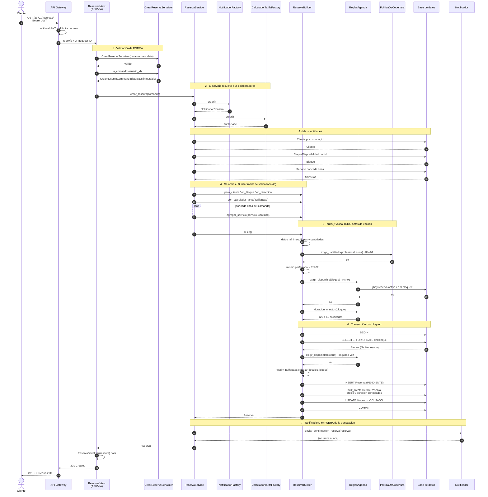
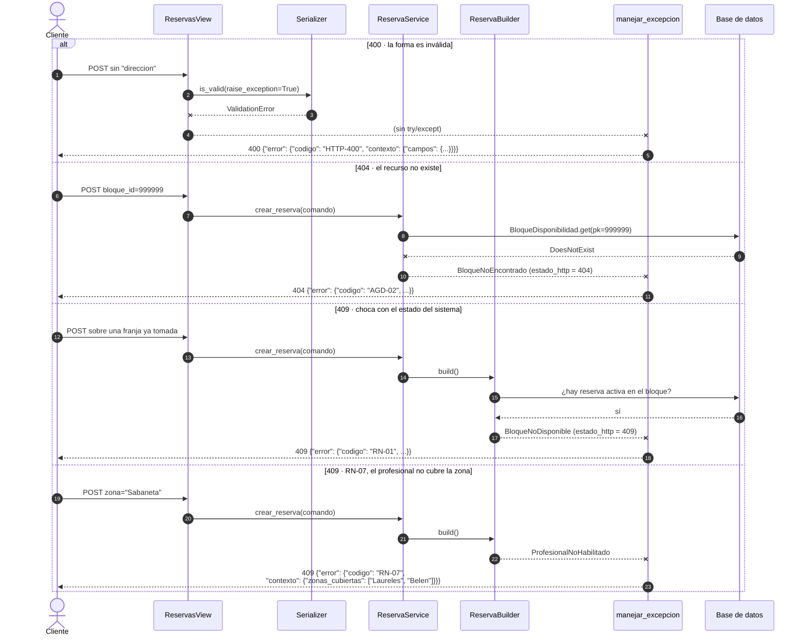
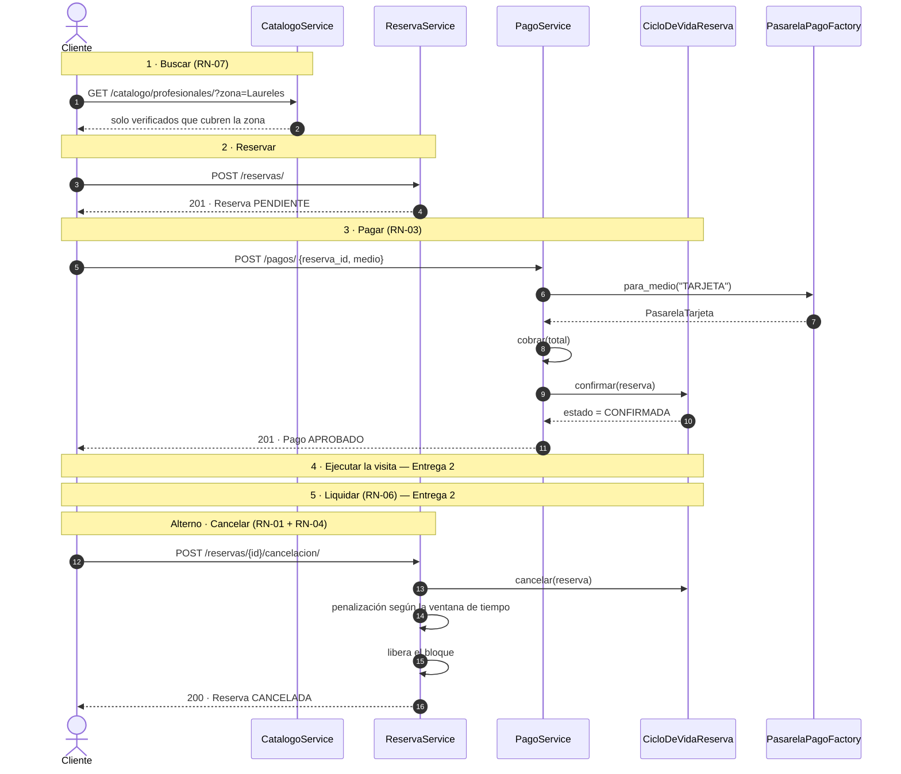
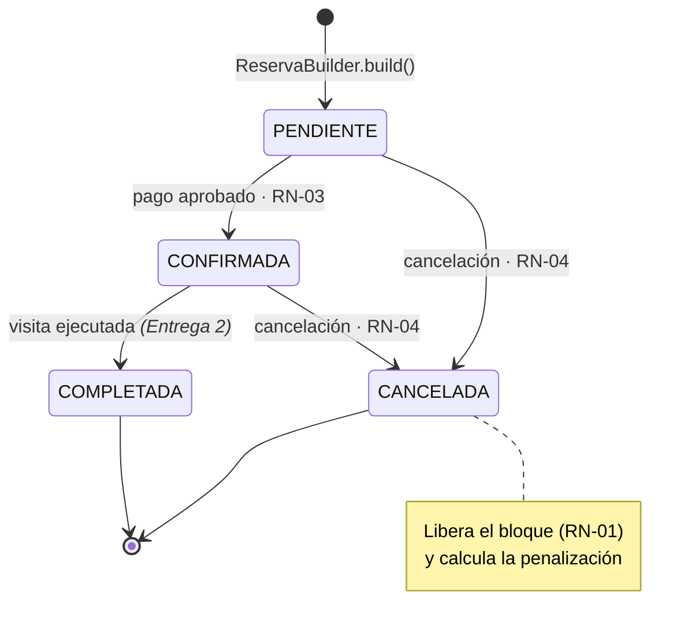

# 05 · Diagrama de Secuencia

La funcionalidad más compleja implementada es **crear una reserva**:
`POST /api/v1/reservas/`.

Es la que atraviesa las cinco capas, dispara el Builder y las dos Factories del
módulo de reservas, valida siete reglas de negocio y abre una transacción con
bloqueo de fila. También es donde se ve, en un solo recorrido, por qué la
arquitectura está montada así.

---

## Camino feliz



### Los cuatro momentos que importan

**Paso 1 — la forma se valida antes de tocar nada.**
Un cuerpo mal armado se rechaza con 400 sin abrir una sola conexión a la base
de datos ni ejecutar una sola regla.

**Paso 4 — armar el Builder no valida nada.**
El bucle `agregar_servicio` puede correr en cualquier orden. Si validara sobre
la marcha, no podría decir *qué* profesionales estaban en conflicto: solo que
el segundo no coincidía con el primero.

**Paso 6 — la validación ocurre dos veces, y es a propósito.**
La primera (paso 5) es optimista y barata: rechaza casi todo sin bloquear
nada. La segunda ocurre con la fila del bloque bloqueada. Entre las dos hay
una ventana en la que otro cliente pudo tomar la misma franja, y esa ventana
es exactamente lo que el bloqueo cierra.

**Paso 7 — la notificación queda fuera de la transacción.**
Por dos razones: una llamada de red lenta mantendría el bloqueo abierto más
tiempo del necesario, y una notificación caída no puede tumbar una reserva ya
guardada.

---

## Caminos de error

Todos terminan igual: el dominio lanza su excepción, **nadie la captura en el
camino**, y el manejador central la traduce.



La flecha `V--xH` es la clave del diseño: **la excepción no pasa por la
vista**. DRF la intercepta y llama al manejador configurado en `settings.py`.
Por eso `views.py` no tiene un solo `try/except` y aun así cada error sale con
su código correcto.

Las cuatro ramas están probadas en `apps/reservas/tests/test_api.py`.

---

## El flujo completo del negocio

Crear la reserva es el paso 2 de cinco. Así se ve el ciclo entero de la
sección 1.5 del Business Case, con lo implementado y lo pendiente:



---

## Estados de la reserva

La máquina de estados vive en `apps/reservas/dominio/ciclo_de_vida.py`,
declarada como un diccionario y no repartida en condicionales:

```python
TRANSICIONES_PERMITIDAS = {
    Estado.PENDIENTE:  {Estado.CONFIRMADA, Estado.CANCELADA},
    Estado.CONFIRMADA: {Estado.COMPLETADA, Estado.CANCELADA},
    Estado.COMPLETADA: set(),
    Estado.CANCELADA:  set(),
}
```



Cualquier transición fuera de ese grafo levanta
`TransicionDeEstadoInvalida` → **409**. Por ejemplo, cancelar dos veces:

```python
def test_409_al_cancelar_dos_veces(self):
    self.client.post(url, {}, format="json")
    respuesta = self.client.post(url, {}, format="json")

    self.assertEqual(respuesta.status_code, 409)
    self.assertEqual(respuesta.data["error"]["codigo"], "RES-05")
```
