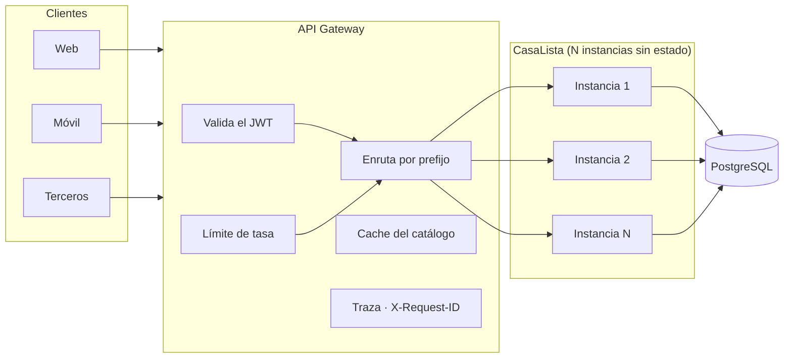
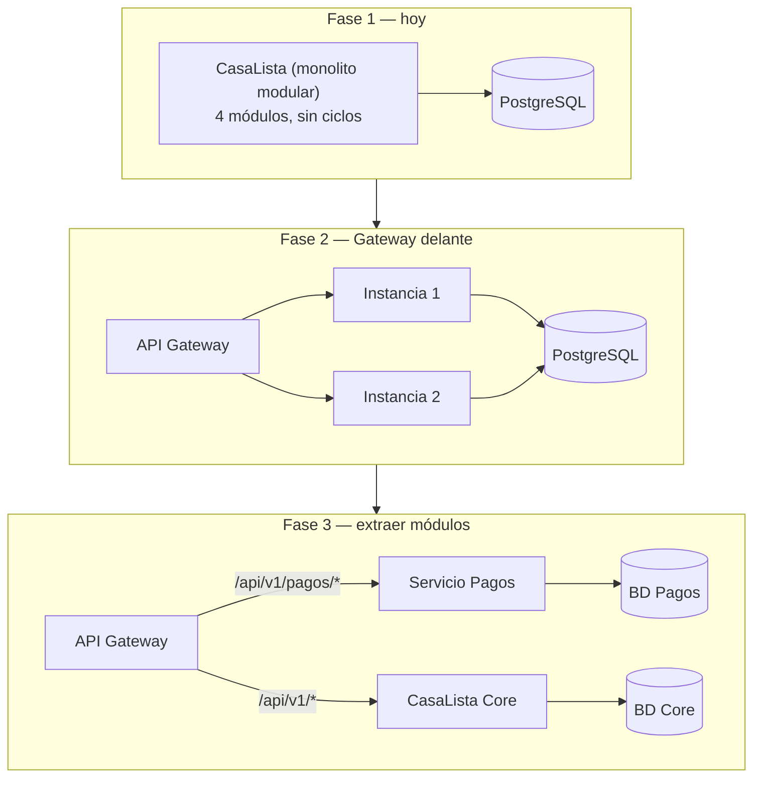

# 06 · API Gateway — Visión de Escalabilidad

## Qué significa "estar preparado para un API Gateway"

Un API Gateway es el único punto de entrada al sistema. Recibe todo el tráfico
externo, y antes de reenviarlo se encarga de lo que no debería resolver cada
servicio por su cuenta: autenticación, límites de tasa, TLS, CORS, cache,
enrutamiento y observabilidad.

Que un sistema *pueda* ponerse detrás de uno no es automático. Exige que la
aplicación cumpla condiciones concretas, y todas ellas se decidieron mientras
se escribía este código. Esta página dice **cuáles son, dónde están y qué
línea de código las hace ciertas**.



---

## Las ocho condiciones, y dónde se cumplen

### 1 · Rutas versionadas y segmentadas por módulo

`config/urls.py`:

```python
API = "api/v1/"

urlpatterns = [
    path(f"{API}cuentas/",   include("apps.cuentas.api.urls")),
    path(f"{API}catalogo/",  include("apps.catalogo.api.urls")),
    path(f"{API}reservas/",  include("apps.reservas.api.urls")),
    path(f"{API}pagos/",     include("apps.pagos.api.urls")),
]
```

Esto no es cosmético. Un Gateway enruta **por prefijo de ruta**, así que hoy
las cuatro rutas apuntan al mismo upstream y el día que un módulo se extraiga
solo cambia una línea de configuración del Gateway:

```yaml
# Hoy — un solo servicio
- path: /api/v1/*          → casalista-monolito

# Después de extraer pagos — sin tocar el código de CasaLista
- path: /api/v1/pagos/*    → casalista-pagos
- path: /api/v1/*          → casalista-monolito
```

Los clientes no se enteran: la URL pública es la misma. Y el `/v1/` permite
publicar una `v2` incompatible sin romper a nadie.

### 2 · Autenticación sin estado (JWT)

```python
"DEFAULT_AUTHENTICATION_CLASSES": [
    "rest_framework_simplejwt.authentication.JWTAuthentication",
    "rest_framework.authentication.SessionAuthentication",
],
```

Es la condición más importante de todas. Con sesiones de Django, la identidad
del usuario vive en la base de datos del servidor: el Gateway no puede
validarla y hay que garantizar que cada cliente vuelva siempre a la misma
instancia (*sticky sessions*), lo que arruina el balanceo.

Un JWT es autocontenido y firmado. Eso habilita tres cosas:

- El **Gateway puede rechazar un token inválido en el borde**, sin gastar una
  petición contra la aplicación.
- Cualquier instancia puede atender cualquier petición: se puede escalar
  horizontalmente sin coordinar nada.
- Cuando `pagos` se extraiga, el mismo token sirve para los dos servicios sin
  compartir almacén de sesiones.

La sesión queda solo como comodidad para navegar la API desde el navegador en
desarrollo.

### 3 · Contrato OpenAPI publicado

```
GET /api/schema/    → el esquema (YAML)
GET /api/docs/      → Swagger UI
```

Es lo que convierte la API en algo que un Gateway puede **importar**, no
adivinar. AWS API Gateway, Kong y APISIX generan rutas, validación de
peticiones y su portal de desarrolladores a partir de un archivo OpenAPI.

El esquema no se escribe a mano: `drf-spectacular` lo genera del código, así
que no puede quedar desactualizado. Cada vista lo enriquece:

```python
@extend_schema(
    summary="Crear una reserva (Builder + Factory)",
    request=CrearReservaSerializer,
    responses={201: ReservaSerializer},
    tags=["reservas"],
)
def post(self, request):
```

Los `tags` agrupan las 16 operaciones por módulo (`cuentas`, `catalogo`,
`agenda`, `reservas`, `pagos`, `operacion`) — que es la misma división por la
que el Gateway enrutaría.

Hay una prueba que falla si el esquema deja de generarse, porque eso dejaría
al Gateway sin contrato:

```python
def test_el_esquema_se_publica(self):
    respuesta = self.client.get(reverse("esquema"))
    self.assertEqual(respuesta.status_code, 200)
```

### 4 · Errores con una forma única

Todos los errores de la API, vengan de donde vengan, salen así:

```json
{
  "error": {
    "codigo": "RN-01",
    "mensaje": "La franja horaria ya fue tomada.",
    "contexto": {"bloque_id": 7}
  }
}
```

Un Gateway que observa el tráfico puede contar errores por código, alertar
sobre picos de `RN-01` (señal de que el catálogo está mostrando franjas
ocupadas) y transformar respuestas sin tener que entender cuatro formatos
distintos. La normalización está en `manejador_errores.py`, que envuelve
incluso los errores nativos de DRF.

### 5 · Códigos HTTP semánticos

El Gateway toma decisiones automáticas según el código: reintentar, abrir un
*circuit breaker*, sacar la instancia del pool. Eso solo funciona si los
códigos significan lo que dicen.

| Código | Cuándo | Qué hace el Gateway |
|---|---|---|
| 400 | el cuerpo es inválido | no reintenta: reintentar daría lo mismo |
| 401 | falta el token o es inválido | puede rechazarlo antes de llegar aquí |
| 403 | el recurso es de otro usuario | no reintenta |
| 404 | el recurso no existe | no reintenta |
| 409 | choca con el estado actual | no reintenta: es una decisión de negocio |
| 502 | la pasarela externa no respondió | **sí** reintenta o abre el breaker |
| 503 | la instancia no está sana | la saca del pool |

El 502 merece mención. Un pago rechazado por falta de fondos es **409**, no
502: la pasarela respondió bien, lo que pasa es que la respuesta fue "no".
Reintentar eso sería inútil. Un 502 dice *"el sistema falló"*, y ahí sí tiene
sentido reintentar. La distinción está en `apps/pagos/dominio/excepciones.py`:

```python
class PagoRechazado(ReglaDeNegocioViolada):      # 409
    codigo = "PAG-04"

class PasarelaNoDisponible(ReglaDeNegocioViolada):
    codigo = "PAG-05"
    estado_http = 502                             # ← sí es fallo de infraestructura
```

### 6 · Endpoint de salud

```
GET /api/v1/salud/
```

```json
{"servicio": "casalista-api", "version": "1.0.0",
 "base_de_datos": "ok", "id_peticion": "a3f9..."}
```

Sin autenticación, sin límite de tasa, y comprueba de verdad la base de datos
con un `SELECT 1`. Devuelve **503** —no 500— cuando la base no responde,
porque 503 le dice al balanceador *"sácame del pool"* y 500 le dice *"hay un
bug"*. Son dos reacciones distintas.

### 7 · Correlación de peticiones

`apps/comun/api/middleware.py`:

```python
class IdentificadorDePeticionMiddleware:
    def __call__(self, request):
        request.id_peticion = request.META.get("HTTP_X_REQUEST_ID") or uuid.uuid4().hex
        respuesta = self.siguiente(request)
        respuesta["X-Request-ID"] = request.id_peticion
        return respuesta
```

Detrás de un Gateway, una petición atraviesa varios procesos. Sin un
identificador común, un error reportado por un usuario es imposible de
rastrear. El Gateway inyecta `X-Request-ID`, la aplicación lo respeta si
llega, lo genera si no, y siempre lo devuelve.

Es lo que permite que un cliente diga *"me falló, el id era a3f9"* y que se
encuentre exactamente esa petición en los logs de los tres servicios.

### 8 · Configuración por entorno y confianza en las cabeceras

Ni un solo valor de infraestructura está escrito en el código. Y hay un
interruptor específico para cuando la aplicación se pone detrás del Gateway:

```python
DETRAS_DE_GATEWAY = variable("DJANGO_TRAS_GATEWAY", "0") == "1"
if DETRAS_DE_GATEWAY:
    USE_X_FORWARDED_HOST = True
    SECURE_PROXY_SSL_HEADER = ("HTTP_X_FORWARDED_PROTO", "https")
```

Es necesario porque el Gateway termina TLS: sin esto, Django cree que la
petición llegó por HTTP y construye URLs absolutas con el esquema equivocado.
Está apagado por defecto: activarlo sin un proxy delante permitiría a un
cliente falsificar esas cabeceras.

---

## Responsabilidades: qué queda de cada lado

Hay funciones que hoy resuelve la aplicación y que **deberían** migrar al
Gateway. Están implementadas de forma provisional y marcadas como tales:

| Función | Hoy | En producción | Por qué mover |
|---|---|---|---|
| Límite de tasa | throttling de DRF (60/min anón, 300/min usuario) | Gateway | La aplicación cuenta por instancia; con 3 instancias el límite real se triplica |
| CORS | `django-cors-headers` | Gateway | Es política de borde; centralizarla evita configurarla en cada servicio |
| TLS | — | Gateway | Un solo certificado en vez de uno por instancia |
| Cache del catálogo | — | Gateway | El endpoint más consultado no tiene por qué llegar a la aplicación |
| Autenticación | valida el JWT | Gateway valida, la app solo lee las claims | Rechazar en el borde ahorra la petición entera |

```python
# settings.py
"DEFAULT_THROTTLE_CLASSES": [...],   # Límite provisional: en producción lo asume el Gateway.
```

Lo que **nunca** se mueve al Gateway: las reglas de negocio. RN-01, RN-02,
RN-04 y RN-07 se quedan en el dominio. Un Gateway que empieza a saber si un
profesional cubre una zona deja de ser un gateway y se convierte en un
segundo lugar donde vive el negocio.

---

## Camino de evolución



### Por qué la Fase 3 es realista y no una promesa

El Business Case dice que Reputación es el candidato natural a extraerse y
Pagos el segundo. El código lo respalda:

- **No hay ciclos de dependencia.** `pagos` importa de `reservas`; `reservas`
  nunca importa de `pagos`. Se puede comprobar leyendo los `import`.
- **`pagos` es una hoja del grafo.** Nadie depende de él.
- **La superficie de acoplamiento es mínima.** `PagoService` usa exactamente
  tres cosas del módulo de reservas: `ConsultaReservasService.detalle_de()`,
  `CicloDeVidaReserva.confirmar()` y el campo `reserva.total`.

Extraerlo significa reemplazar esas tres llamadas por HTTP (o por un evento
`ReservaPagada`), no reescribir el sistema.

### Qué habría que resolver al extraerlo

Ser honesto sobre esto es parte del análisis:

- **La transacción se rompe.** Hoy guardar el pago y confirmar la reserva están
  en un solo `transaction.atomic()`. Repartidos en dos servicios haría falta
  un patrón de consistencia eventual (Saga o *outbox*).
- **La comprobación de propiedad cruza el límite.** `PagoService` verifica que
  la reserva sea del cliente llamando al módulo de reservas; eso pasaría a ser
  una llamada de red con su latencia y su modo de fallo.
- **`Liquidación` se lleva a `Pago` consigo** (son composición en el diagrama),
  lo cual es coherente: el módulo se lleva su agregado completo.

Ninguno de esos tres problemas se resuelve en esta entrega, y no se pretende
lo contrario. Lo que sí está hecho es lo que los hace *resolubles*: las
fronteras ya están donde tienen que estar.
